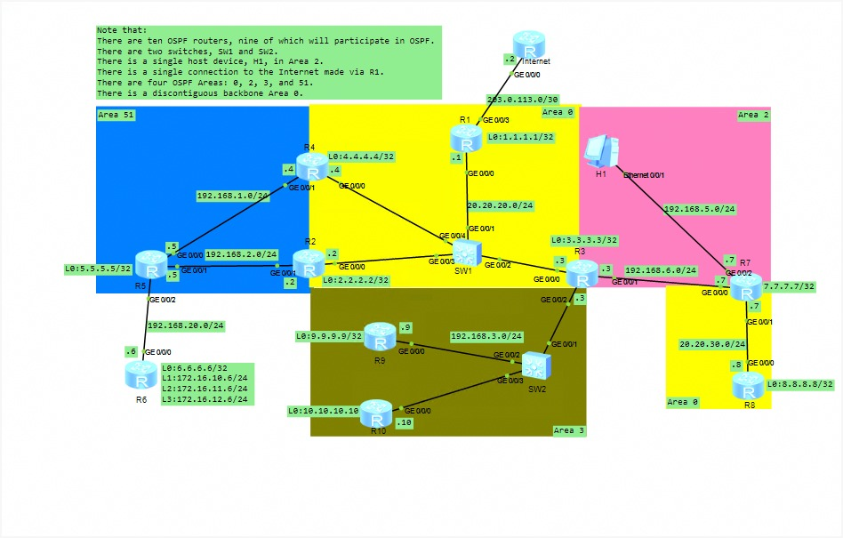

As you embark on this design, you will configure OSPF to meet the needs of the growing network. 
Your work will include:

Basic OSPF setups, advertising networks, adjusting costs, and implementing authentication and security measures.
Establishing OSPF neighbour adjacencies, fine-tuning router IDs, and managing DR/BDR elections along with hello and dead intervals.
Addressing the nuances of different network types.
Developing a multi-area OSPF topology, incorporating various stub configurations and virtual links.
Utilizing OSPFv3 to support a planned expansion using IPv6.
Advanced OSPF configurations, focusing on path preference, load balancing, and LSA filtering and distribute lists.


Note that:

There are ten OSPF routers, nine of which will participate in OSPF.

There are two switches, SW1 and SW2.

There is a single host device, H1, in Area 2.

There is a single connection to the Internet made via R1.

There are four OSPF Areas: 0, 2, 3, and 51.

There is a discontiguous backbone Area 0.



### OSPF CONFIGURATIONS ON HUAWEI ROUTER:

```
🟡 Area 0 / Area 51 Border Routers


Router 1 (R1) — Backbone Hub & Internet Gateway


[R1] ospf 1 router-id 1.1.1.1
[R1-ospf-1] silent-interface LoopBack0
[R1-ospf-1] area 0.0.0.0
[R1-ospf-1-area-0.0.0.0] network 1.1.1.1 0.0.0.0
[R1-ospf-1-area-0.0.0.0] network 20.20.20.0 0.0.0.255
[R1-ospf-1-area-0.0.0.0] quit
[R1-ospf-1] default-route-advertise always
[R1-ospf-1] quit
[R1] ip route-static 0.0.0.0 0.0.0.0 203.0.113.2
Use code with caution.

Router 2 (R2) — ABR (Area 0 / Area 51)

huawei
[R2] ospf 1 router-id 2.2.2.2
[R2-ospf-1] silent-interface LoopBack0
[R2-ospf-1] area 0.0.0.0
[R2-ospf-1-area-0.0.0.0] network 2.2.2.2 0.0.0.0
[R2-ospf-1-area-0.0.0.0] network 20.20.20.0 0.0.0.255
[R2-ospf-1-area-0.0.0.0] quit
[R2-ospf-1] area 0.0.0.51
[R2-ospf-1-area-0.0.0.51] network 192.168.2.0 0.0.0.255
[R2-ospf-1-area-0.0.0.51] quit
Use code with caution.

Router 4 (R4) — ABR (Area 0 / Area 51)

huawei
[R4] ospf 1 router-id 4.4.4.4
[R4-ospf-1] silent-interface LoopBack0
[R4-ospf-1] area 0.0.0.0
[R4-ospf-1-area-0.0.0.0] network 4.4.4.4 0.0.0.0
[R4-ospf-1-area-0.0.0.0] network 20.20.20.0 0.0.0.255
[R4-ospf-1-area-0.0.0.0] quit
[R4-ospf-1] area 0.0.0.51
[R4-ospf-1-area-0.0.0.51] network 192.168.1.0 0.0.0.255
[R4-ospf-1-area-0.0.0.51] quit
Use code with caution.

🔵 Area 51 Internal Routers


Router 5 (R5) — Internal Area 51 Router

huawei
[R5] ospf 1 router-id 5.5.5.5
[R5-ospf-1] silent-interface LoopBack0
[R5-ospf-1] area 0.0.0.51
[R5-ospf-1-area-0.0.0.51] network 5.5.5.5 0.0.0.0
[R5-ospf-1-area-0.0.0.51] network 192.168.1.0 0.0.0.255
[R5-ospf-1-area-0.0.0.51] network 192.168.2.0 0.0.0.255
[R5-ospf-1-area-0.0.0.51] network 192.168.20.0 0.0.0.255
[R5-ospf-1-area-0.0.0.51] quit
Use code with caution.

Router 6 (R6) — Internal Area 51 Router

huawei
[R6] ospf 1 router-id 6.6.6.6
[R6-ospf-1] silent-interface LoopBack1
[R6-ospf-1] silent-interface LoopBack2
[R6-ospf-1] silent-interface LoopBack3
[R6-ospf-1] area 0.0.0.51
[R6-ospf-1-area-0.0.0.51] network 6.6.6.6 0.0.0.0
[R6-ospf-1-area-0.0.0.51] network 192.168.20.0 0.0.0.255
[R6-ospf-1-area-0.0.0.51] network 172.16.10.0 0.0.0.255
[R6-ospf-1-area-0.0.0.51] network 172.16.11.0 0.0.0.255
[R6-ospf-1-area-0.0.0.51] network 172.16.12.0 0.0.0.255
[R6-ospf-1-area-0.0.0.51] quit
Use code with caution.

🟢🟫 Multi-Area Core Router


Router 3 (R3) — ABR (Area 0 / Area 2 / Area 3)

huawei
[R3] ospf 1 router-id 3.3.3.3
[R3-ospf-1] silent-interface LoopBack0
[R3-ospf-1] area 0.0.0.0
[R3-ospf-1-area-0.0.0.0] network 3.3.3.3 0.0.0.0
[R3-ospf-1-area-0.0.0.0] network 20.20.20.0 0.0.0.255
[R3-ospf-1-area-0.0.0.0] quit
[R3-ospf-1] area 0.0.0.2
[R3-ospf-1-area-0.0.0.2] network 192.168.6.0 0.0.0.255
[R3-ospf-1-area-0.0.0.2] quit
[R3-ospf-1] area 0.0.0.3
[R3-ospf-1-area-0.0.0.3] network 192.168.3.0 0.0.0.255
[R3-ospf-1-area-0.0.0.3] quit
Use code with caution.

🟫 Area 3 Internal Routers


Router 9 (R9) — Internal Area 3 Router

huawei
[R9] ospf 1 router-id 9.9.9.9
[R9-ospf-1] silent-interface LoopBack0
[R9-ospf-1] area 0.0.0.3
[R9-ospf-1-area-0.0.0.3] network 9.9.9.9 0.0.0.0
[R9-ospf-1-area-0.0.0.3] network 192.168.3.0 0.0.0.255
[R9-ospf-1-area-0.0.0.3] quit
Use code with caution.

Router 10 (R10) — Internal Area 3 Router

huawei
[R10] ospf 1 router-id 10.10.10.10
[R10-ospf-1] silent-interface LoopBack0
[R10-ospf-1] area 0.0.0.3
[R10-ospf-1-area-0.0.0.3] network 10.10.10.10 0.0.0.0
[R10-ospf-1-area-0.0.0.3] network 192.168.3.0 0.0.0.255
[R10-ospf-1-area-0.0.0.3] quit
Use code with caution.

🟢🟡 Isolated Backbone Section (Area 2 / Area 0)


Router 7 (R7) — ABR (Area 2 / Area 0 Segment)

huawei
[R7] ospf 1 router-id 7.7.7.7
[R7-ospf-1] silent-interface Ethernet0/0/1
[R7-ospf-1] area 0.0.0.2
[R7-ospf-1-area-0.0.0.2] network 7.7.7.7 0.0.0.0
[R7-ospf-1-area-0.0.0.2] network 192.168.5.0 0.0.0.255
[R7-ospf-1-area-0.0.0.2] network 192.168.6.0 0.0.0.255
[R7-ospf-1-area-0.0.0.2] quit
[R7-ospf-1] area 0.0.0.0
[R7-ospf-1-area-0.0.0.0] network 20.20.30.0 0.0.0.255
[R7-ospf-1-area-0.0.0.0] quit
Use code with caution.

Router 8 (R8) — Internal Area 0 Segment Router

huawei
[R8] ospf 1 router-id 8.8.8.8
[R8-ospf-1] silent-interface LoopBack0
[R8-ospf-1] area 0.0.0.0
[R8-ospf-1-area-0.0.0.0] network 8.8.8.8 0.0.0.0
[R8-ospf-1-area-0.0.0.0] network 20.20.30.0 0.0.0.255
[R8-ospf-1-area-0.0.0.0] quit

```
